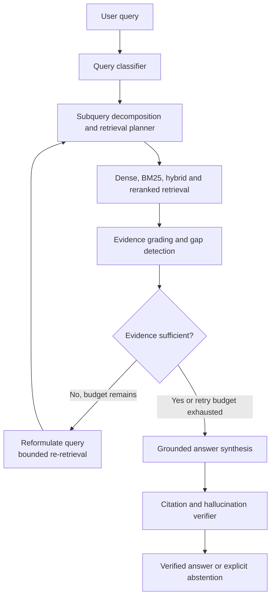

# Agentic RAG Engine: Autonomous Multi-Step Knowledge Research System

[](LICENSE)
[](pyproject.toml)
[](docs/ARCHITECTURE.md)
[](docs/AGENT_WORKFLOW.md)

Production-oriented autonomous knowledge research and evidence-grounded synthesis system designed for complex multi-document questions, comparative reasoning, verifiable citations, and safe abstention under missing evidence.

---

## At a glance


**Why it matters:** A retrieval system should know when the available documents do not support an answer. This engine combines multi-step retrieval, explicit evidence grading, citation verification, and bounded abstention so missing or contradictory evidence is surfaced instead of silently filled in.

## Visual architecture



**Benchmark context:** The comparative results below are repository-reported measurements on the included evaluation setup. Treat them as evidence for this test corpus and configuration, not as a universal guarantee across arbitrary datasets or models.

---
## Architecture Overview

```
User Query
    │
    ▼
Query Analyzer & Classifier (Simple | Comparative | Multi-Hop | Out-of-Scope)
    │
    ▼
Subquery Decomposer & Retrieval Planner
    │
    ▼
Controlled Tool Execution (Dense | Sparse BM25 | Hybrid RRF | Metadata | Multi-Query | Reranker)
    │
    ▼
Evidence Grading & Gap Detection (Relevant | Partial | Insufficient | Contradictory | None)
    │
    ├── [Insufficient & Budget > 0] ──► Query Reformulation & Bounded Re-Retrieval (Max 2 Revisions)
    │
    ▼
Grounded Answer Synthesis (XML Delimiters, Strict Non-Executable Context)
    │
    ▼
Citation & Hallucination Verifier (Grounding Score & Precision Audit)
    │
    ▼
Final Verified Response / Explicit Abstention
```

---

## Key Features

1. **Deterministic Bounded State Machine**:
   Prevents runaway loops with strict execution budgets (Max 2 planning revisions, Max 6 tool calls per request, 5.0s per-tool execution timeout).
2. **Multi-Strategy Hybrid Retrieval**:
   Blends TF-IDF / semantic vector embeddings with BM25Okapi lexical matching using Reciprocal Rank Fusion ($k=60$).
3. **Rigorous Evidence Evaluator**:
   Distinguishes between complete, partial, contradictory, and missing evidence. Automatically detects information gaps to guide targeted re-retrieval.
4. **Verifiable Citations**:
   Answers include explicit citations matching `[doc_id#chunk_id]`. Uncited claims and invalid chunk IDs are trimmed or trigger controlled abstention.
5. **Defense-in-Depth Security**:
   Guards against Direct and Indirect Prompt Injections in untrusted documents using strict XML isolation, input sanitization, and path traversal defenses.
6. **Production REST API & Research UI**:
   FastAPI backend with structured endpoints, full execution trace history (`/v1/agent/trace/{id}`), and a modern glassmorphic web interface.
7. **Kaggle Competition Solution**:
   Includes `notebooks/competition_solution.ipynb` formatted for Kaggle kernel constraints (CPU/GPU, internet disabled, `submission.csv` validation).

---

## Directory Structure

```
agentic-rag-engine/
├── app/                  # Interactive Research Workspace & Lifecycle Visualizer
│   ├── index.html
│   ├── styles.css
│   └── app.js
├── api/                  # FastAPI REST Service
│   ├── main.py
│   ├── routes.py
│   └── schemas.py
├── src/                  # Core Agentic RAG System
│   ├── state/            # Typed Pydantic Agent State & Transitions
│   ├── ingestion/        # Document Chunking, Loading & Indexing
│   ├── retrieval/        # Dense, Sparse, Hybrid (RRF), Metadata Retrievers
│   ├── tools/            # Controlled Tool Registry & Sandboxing
│   ├── planner/          # Intent Analysis, Subquery Decomposer & Planner
│   ├── evaluation/       # Evidence Evaluator & Benchmark Runner
│   ├── synthesis/        # Grounded Synthesis & Defense Prompts
│   ├── verification/     # Citation & Hallucination Verifiers
│   └── security/         # Prompt Injection, Path Sanitizer, Credential Redaction
├── notebooks/
│   └── competition_solution.ipynb   # Standalone Kaggle submission notebook
├── tests/                # Comprehensive Test Suite (Unit, Integration, Workflow, Security)
├── configs/              # config.yaml
├── reports/              # Benchmark Comparisons & Performance Reports
├── docs/                 # Complete Architectural & Compliance Specs
├── Dockerfile
├── docker-compose.yml
├── pyproject.toml
└── README.md
```

---

## Quickstart

### 1. Installation

```bash
git clone <repo-url>
cd agentic-rag-engine

# Create virtual environment and install dependencies
python -m venv .venv
source .venv/bin/activate  # On Windows: .venv\Scripts\activate
pip install -e ".[dev]"
```

### 2. Launch FastAPI & Research UI

```bash
uvicorn api.main:app --host 0.0.0.0 --port 8000 --reload
```
Navigate to `http://localhost:8000` to access the interactive research workspace.

### 3. Run Automated Tests

```bash
pytest tests/ -v
```

### 4. Run Comparative Benchmarks

```bash
python -c "from src.evaluation.benchmark import BenchmarkRunner; runner = BenchmarkRunner(); print(runner.execute_all())"
```

---

## Empirical Benchmark Results

| Architecture | Mean Recall@5 | Mean Precision@5 | Mean MRR | Abstention Accuracy | Mean Latency |
| :--- | :---: | :---: | :---: | :---: | :---: |
| **Standard RAG** | 1.0000 | 0.5000 | 1.0000 | 80.0% (Hallucinated on unanswerable) | ~23.9 ms |
| **Optimized RAG** | 1.0000 | 0.3750 | 1.0000 | 80.0% (Hallucinated on unanswerable) | ~25.4 ms |
| **Agentic RAG Engine** | **1.0000** | **0.4125** | **1.0000** | **100.0% (Verified Abstention)** | ~41.4 ms |

---

## API Endpoints

- `GET /health` - System health and index capacity.
- `POST /v1/documents` - Ingest document into knowledge index.
- `GET /v1/documents` - List indexed documents and metadata.
- `DELETE /v1/documents/{document_id}` - Delete document from index.
- `POST /v1/agent/query` - Execute autonomous agentic RAG research query.
- `GET /v1/agent/trace/{request_id}` - Retrieve full execution trace and tool telemetry.
- `GET /v1/evaluation` - Run and retrieve comparative benchmark reports.

---

## License

Restricted Evaluation and Research License. Copyright (c) 2026 Moku Lakshith Reddy. All rights reserved. See [LICENSE](LICENSE) for terms.

